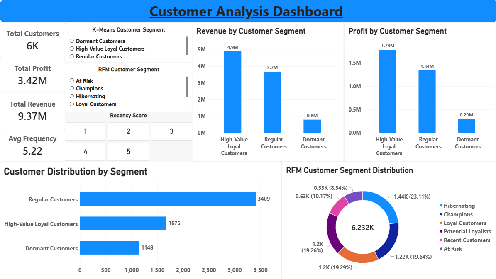

# Customer Segmentation Analysis

## Project Overview

This project focuses on analyzing customer purchasing behavior and identifying different customer groups using **RFM Analysis** and **K-Means Clustering**.

The goal is to understand customer value, purchasing patterns, and customer engagement to support better business decisions.


## Problem Statement

Businesses often have customers with different purchasing behaviors, spending patterns, and levels of engagement. However, without proper customer analysis, it can be difficult to identify high-value customers, understand inactive customers, and develop effective customer retention strategies.

This project addresses this problem by analyzing customer transaction data using RFM Analysis and K-Means Clustering. It aims to group customers based on their purchasing behavior, identify valuable customer segments, and generate insights that can help businesses improve customer engagement, retention, and marketing strategies.


## Project Objectives

- Analyze customer purchasing behavior.
- Identify active and inactive customers.
- Perform Recency, Frequency, and Monetary (RFM) analysis.
- Segment customers using K-Means clustering.
- Compare RFM segments with K-Means results.
- Develop business insights and recommendations.
- Build an interactive dashboard using Power BI.

## Tools and Technologies

- Python
- Pandas
- NumPy
- Matplotlib
- Seaborn
- Scikit-learn
- Jupyter Notebook
- Power BI
- Git and GitHub

## Dataset Description

The project uses a customer segmentation dataset containing four main tables:

| Dataset | Description |
|---|---|
| Customers | Customer information and signup details |
| Transactions | Customer purchase and transaction details |
| Products | Product names, categories, and prices |
| Annual Summary | Yearly sales and transaction summaries |

**Dataset Overview:**
- 6,500 customers
- 32,500 transactions
- 18 products
- Transaction records from 2021 to 2025

## Project Workflow

1. **Data Understanding** – Examined the dataset structure, columns, and data types.
2. **Data Cleaning** – Checked missing values, duplicates, and invalid records.
3. **Exploratory Data Analysis (EDA)** – Analyzed sales, profit, products, regions, and customer behavior.
4. **Customer Analysis** – Examined customer spending and purchasing frequency.
5. **RFM Analysis** – Segmented customers based on Recency, Frequency, and Monetary values.
6. **K-Means Clustering** – Applied machine learning to identify customer groups.
7. **Segment Comparison** – Compared rule-based RFM segments with K-Means clusters.
8. **Business Insights** – Developed recommendations based on customer behavior.
9. **Power BI Dashboard** – Created an interactive dashboard to present the results.

## Customer Segmentation Results

K-Means clustering identified three customer groups:

| Customer Segment | Customers | Percentage |
|---|---:|---:|
| Dormant Customers | 1,148 | 18.42% |
| Regular Customers | 3,409 | 54.70% |
| High-Value Loyal Customers | 1,675 | 26.88% |
| **Total** | **6,232** | **100%** |

## Key Business Insights

- High-Value Loyal Customers contribute the largest share of revenue and profit.
- Regular Customers represent the largest customer group.
- Dormant Customers may require targeted re-engagement campaigns.
- RFM and K-Means provide complementary ways to understand customer behavior.


## Learning Outcomes

Through this project, I gained practical experience in:

- Understanding and exploring real-world structured datasets.
- Cleaning and preprocessing data using Python and Pandas.
- Performing Exploratory Data Analysis (EDA) to identify trends and patterns.
- Analyzing customer purchasing behavior using Recency, Frequency, and Monetary (RFM) metrics.
- Applying K-Means Clustering for customer segmentation.
- Using StandardScaler to prepare data for machine learning.
- Comparing rule-based RFM segments with K-Means clustering results.
- Creating visualizations using Matplotlib and Seaborn.
- Developing business insights and recommendations from data.
- Building an interactive dashboard using Power BI.
- Organizing and managing a data analytics project using Git and GitHub.


## Power BI Dashboard

An interactive Power BI dashboard was developed to present customer segmentation results and analyze customer behavior, revenue, and profitability.

### Key Performance Indicators (KPIs)

The dashboard includes four main KPIs:

- **Total Customers:** Displays the total number of customers included in the segmentation analysis.
- **Total Revenue:** Shows the overall revenue generated by customers.
- **Total Profit:** Displays the total profit generated from customer transactions.
- **Average Frequency:** Represents the average number of transactions per customer.

### Dashboard Visualizations

The dashboard includes the following visualizations:

- **Customer Distribution by Segment:** Shows the number of customers in each K-Means customer segment.
- **Revenue by Customer Segment:** Compares the total revenue generated by different customer groups.
- **Profit by Customer Segment:** Highlights the contribution of each customer segment to overall profit.
- **RFM Customer Segment Distribution:** Displays the distribution of customers across different RFM segments using a donut chart.

### Interactive Filters (Slicers)

Users can interact with the dashboard using three slicers:

- **K-Means Customer Segment:** Filter customers by Dormant Customers, Regular Customers, and High-Value Loyal Customers.
- **RFM Customer Segment:** Filter customers by their RFM-based categories.
- **Recency Score:** Filter customers based on their most recent purchasing activity.

These filters allow users to explore customer segments and compare their revenue, profit, and purchasing frequency.

### Dashboard Preview



### Dashboard File

The Power BI dashboard file is available in:

`outputs/reports/Customer_Segmentation_Dashboard.pbix`

## Repository Structure

```text
Customer-Segmentation-Analysis/
│
├── data/
│   ├── raw/
│   └── processed/
│
├── notebooks/
│   ├── 01_Data_Understanding.ipynb
│   ├── 02_Data_cleaning.ipynb
│   ├── 03_Exploratory_Data_Analysis.ipynb
│   ├── 04_Customer_Analysis.ipynb
│   ├── 05_RFM_Analysis.ipynb
│   └── 06_Customer_Segmentation.ipynb
│
├── outputs/
│   ├── figures/
│   ├── processed_data/
│   └── reports/
│
├── src/
├── app.py
├── requirements.txt
└── README.md
```
## How to Run the Project

1. Clone the repository:

```bash
git clone https://github.com/6sandesh9/Customer-Segmentation-Analysis.git
```

2. Navigate to the project folder:

```bash
cd Customer-Segmentation-Analysis
```

3. Install the required libraries:

```bash
pip install -r requirements.txt
```

4. Open the Jupyter notebooks and run the analysis.

## Author

**Sandesh Shrestha**

Aspiring Data Analyst | BIM Student
